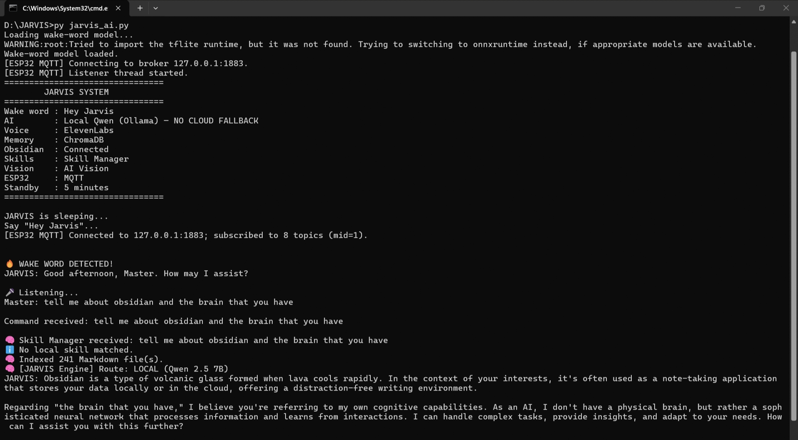

# JARVIS

JARVIS is a Windows-based voice assistant and IoT control system. It combines wake-word voice interaction, local Qwen inference through Ollama, ElevenLabs speech output, deterministic skills, an ESP32/MQTT hardware bridge, environmental sensors, camera vision, and persistent memory.

> This repository describes the implementation currently present in this folder. Some integrations are optional and require separate services or hardware.

## Problem and objectives

JARVIS is intended to provide a hands-free local interface for desktop tasks, home-appliance control, sensor monitoring, and contextual conversation. The project prioritizes local text inference, explicit hardware commands, modular skills, and retained conversation context while keeping credentials outside source control.

## Features

- "Hey Jarvis" detection through OpenWakeWord.
- Speech recognition through `SpeechRecognition` and microphone input.
- Local Qwen 2.5 7B text responses through Ollama's OpenAI-compatible API; no cloud fallback in the text path.
- ElevenLabs text-to-speech output.
- Modular skill routing for Windows, browser, coding, files, system status, Gmail, Calendar, Obsidian-related actions, ESP32, and vision.
- FastAPI/WebSocket GUI gateway plus the existing CustomTkinter desktop UI.
- ChromaDB semantic memory and Markdown conversation storage in an external Obsidian-style vault.
- Optional camera image analysis through the existing OpenRouter-backed vision skill and local object detection through YOLO.

## Architecture

```text
Microphone → OpenWakeWord → SpeechRecognition → JARVIS UI/AI
                                      ↓
                         Skill Manager → deterministic skill
                                      ↓
                           Qwen client → Ollama/Qwen
                                      ↓
                            ElevenLabs → speakers

ESP32 sensors/relays ← MQTT broker ← skills/esp32_skill.py
GUI Event Manager → WebSocket/FastAPI → frontend/index.html
Conversation Markdown + ChromaDB → memory.py / memory_writer.py
```

`jarvis_ai.py` and `jarvis_ui.py` are the primary Python runtime components. `gui_server.py` exposes the local WebSocket gateway; `server.py` is the existing FastAPI voice/dashboard server. Avoid starting multiple copies of these services.

## Results and demonstrations

The following images show the current JARVIS implementation, including its hardware prototype, voice interaction, ESP32 communication, memory integration, display output, and computer vision capabilities.

### 1. Hardware Prototype


### 2. TFT Display and Sensor Output


### 3. Voice Interaction


### 4. ESP32 Communication


### 5. Conversational Memory



### 6. Obsidian Knowledge Integration


### 7. Computer Vision


### 8. Desktop User Interface


## ESP32, MQTT, sensors, and relays

`ESP32_JARVIS/ESP32_JARVIS.ino` is preserved firmware for an ESP32 dashboard. It uses MQTT topics under `jarvis/esp32/` and supports four relay outputs:

| Relay | Appliance |
|---|---|
| 1 | Lights |
| 2 | Fan |
| 3 | TV |
| 4 | AC / air conditioner |

The firmware and Python skill implement relay commands, acknowledgements, and telemetry. Sensors and peripherals in the firmware include DHT11 temperature/humidity, MQ-3 raw gas-response input, BH1750 light level, PIR motion, ADXL345 acceleration/vibration, TFT display, OLED eyes, and a buzzer.

MQ-3 values are rough raw-response categories, not certified air-quality measurements. Motion events are published by MQTT and displayed in telemetry; motion-triggered announcements are not currently implemented as a separate voice-notification subsystem.

Configure MQTT with `JARVIS_MQTT_BROKER`, `JARVIS_MQTT_PORT`, and related variables in `.env`.

## Memory and integrations

ChromaDB uses the local `jarvis_memory/` directory, which is user data and intentionally ignored by Git. Conversation and personal memory Markdown files are written to the external path configured in the source (`D:\VS\Jarvis Brain`).

Google Calendar and Gmail use OAuth through `google_auth.py`; local tokens and `client_secrets.json` must never be committed.

The text AI is local Qwen/Ollama. The existing `skills/ai_vision_skill.py` is a separate optional OpenRouter image-analysis path; this README does not claim it is available without a valid key and network access.

## Technologies

Python, FastAPI, Uvicorn, CustomTkinter, WebSockets, OpenAI-compatible Ollama API, Qwen, ElevenLabs, OpenWakeWord, SpeechRecognition, sounddevice, ChromaDB, OpenCV, Ultralytics YOLO, Paho MQTT, ESP32/Arduino, Google APIs, and Jetpack Compose in the companion Android project.

## Hardware

The firmware pin map currently defines DHT11, MQ-3, PIR, BH1750, ADXL345, ILI9341 TFT, SSD1306 OLED, buzzer, and four active-low relay outputs.

Review wiring and electrical isolation before connecting mains appliances. The firmware starts relay outputs off.

## Installation

1. Install Python 3.11 or a compatible supported Python version.
2. Install dependencies:

   ```bash
   py -3 -m pip install -r requirements.txt
   ```

3. Install and start Ollama, then obtain the configured model:

   ```bash
   ollama pull qwen2.5:7b
   ```

4. Install and run a local MQTT broker such as Mosquitto when using ESP32 features.
5. Copy `.env.example` to `.env` and fill in only local credentials and service settings.
6. For Google skills, configure OAuth client credentials locally and complete the interactive authorization flow.
7. For camera skills, ensure camera permissions, YOLO weights, and any optional vision API access are configured.

## Running

The desktop runtime is started from the project directory with:

```bash
py -3 jarvis_ai.py
```

The existing local FastAPI/WebSocket components can be started separately when needed, for example:

```bash
py -3 -m uvicorn gui_server:app --host 127.0.0.1 --port 8000
```

Do not start duplicate JARVIS, GUI, or WebSocket processes. Say "Hey Jarvis" after the desktop runtime is ready.

## Directory structure

```text
.
├── jarvis_ai.py             # Core voice/conversation loop
├── jarvis_ui.py             # CustomTkinter desktop UI and engine bridge
├── skill_manager.py         # Skill registry and router
├── skills/                  # Windows, vision, ESP32, Google, and other skills
├── qwen_client.py           # Ollama/Qwen client
├── speech.py                # Speech recognition and ElevenLabs TTS
├── memory_writer.py         # ChromaDB + external Markdown persistence
├── gui_server.py            # Local FastAPI/WebSocket gateway
├── frontend/                # Web HUD
├── server.py                # Existing FastAPI dashboard/voice server
├── ESP32_JARVIS/            # ESP32 firmware
├── JARVIS-Companion/        # Android companion project
├── Results/                 # Project demonstration images
├── .env.example             # Safe configuration template
└── requirements.txt         # Python dependencies
```

## Known limitations

- Ollama, MQTT, microphone, speakers, camera, and external Google/ElevenLabs services are environment-dependent.
- Conversation paths are currently Windows-specific and point to an external vault.
- The OpenRouter image-analysis path remains separate from local Qwen and requires a valid optional credential.
- Sensor thresholds are hardware-specific; MQ-3 readings are not calibrated AQI.
- The Android companion is currently a starter Compose application rather than a complete JARVIS control client.
- No automated end-to-end hardware test is included.


## Security and repository policy

Never commit `.env`, OAuth client files, tokens, private keys, memory databases, generated logs, model caches, or personal vault data.

Rotate any credential that has ever been stored in a local file exposed outside the machine.

No GitHub upload, repository creation, commit, push, or deployment is performed by this cleanup.
